# AI 果園防猴系統

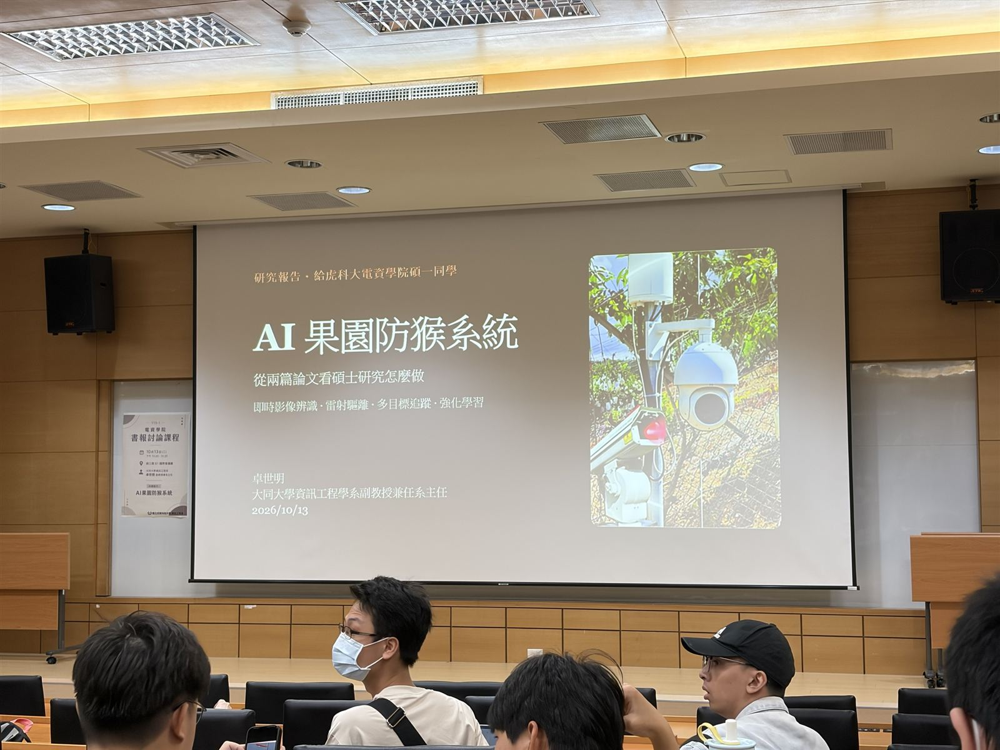

## 核心摘要

本次演講介紹以 **AI 即時影像辨識** 結合 **雷射驅離** 降低獼猴果園損害的研究，系統從固定式攝影機與雷射指向，逐步發展為 **多目標追蹤**、**強化學習（DDPG）**、**RGB 與熱影像融合**，以及 **自主無人機** 協同驅離。

核心發現是：獼猴會對固定、可預測的驅離方式產生 **習慣化（Habituation）**，因此驅離策略必須 **不可預測**，並能依情境調整，才能維持長期效果。

> 高功率雷射可能傷害動物與人眼，實際應用須優先考量安全、法規與野生動物保育。

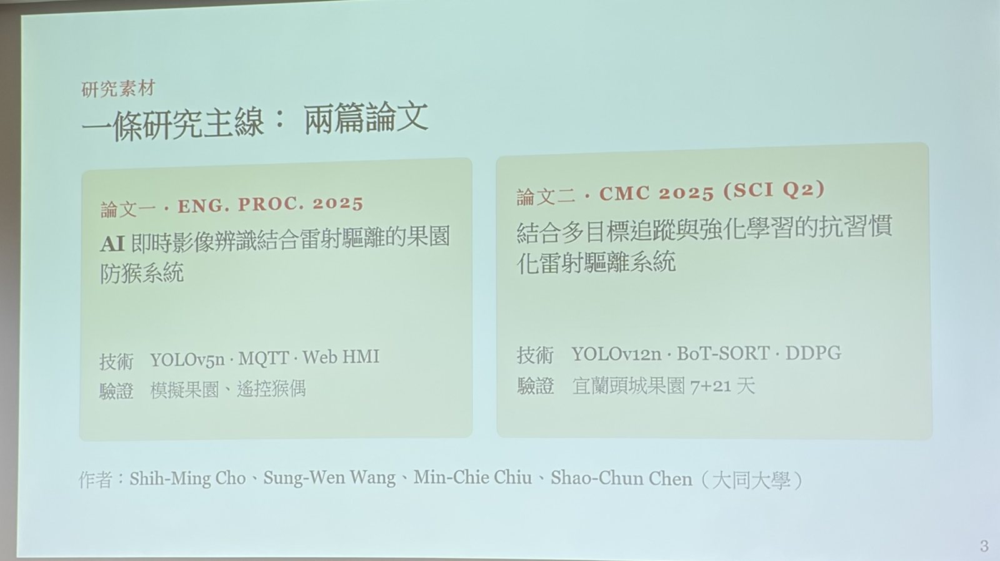

---

## 1. 研究背景與問題動機

- **果園損害**  
  獼猴成群進入果園採食、折枝，且多在果實成熟、採收期間出現。

- **傳統防治的限制**  
  各種方法都有成本或效果上的天花板，而且獼猴很快就會適應。

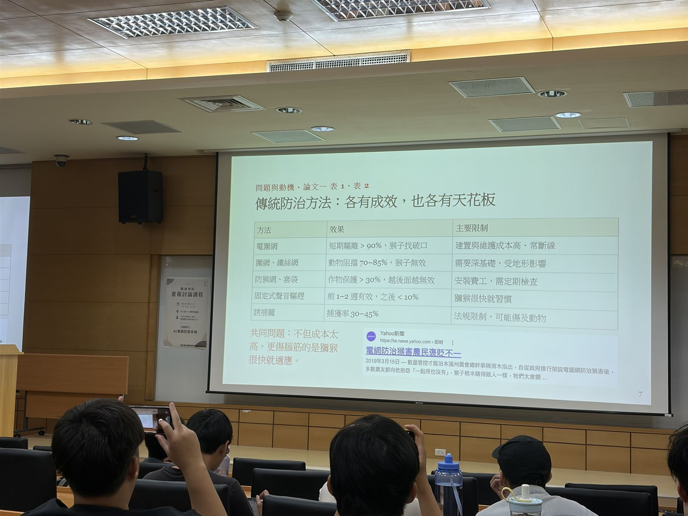

| 方法 | 效果 | 主要限制 |
|---|---|---|
| 電圍網 | 短期驅離 > 90%，猴子找破口 | 建置與維護成本高、常斷線 |
| 圍網、鐵絲網 | 動物阻擋 70–85%，猴子無效 | 需要深基礎，受地形影響 |
| 防猴網、套袋 | 作物保護 > 30%，越後面越無效 | 安裝費工，需定期檢查 |
| 固定式聲音驅趕 | 前 1–2 週有效，之後 < 10% | 獼猴很快就習慣 |
| 誘捕籠 | 捕獲率 30–45% | 法規限制，可能傷及動物 |

- **核心洞見：習慣化**  
  可預測的刺激幾週內就會失效。固定聲音驅趕的減損效果從第 1 週的 **68%** 降到第 5 週的 **12%**（林試所 2021 年 8 週田野試驗）。

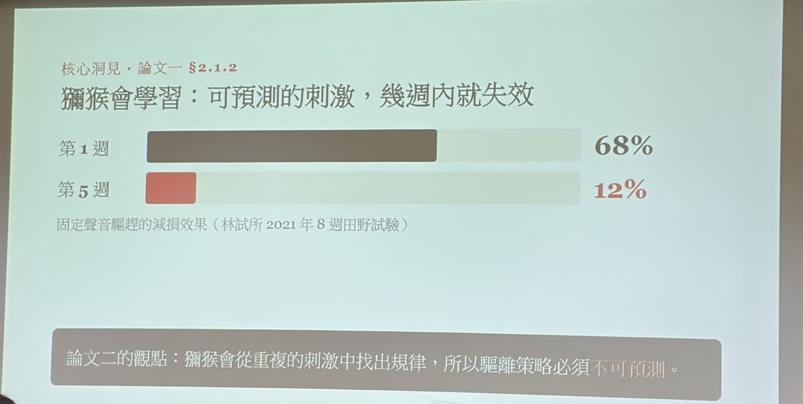

---

## 2. 研究問題

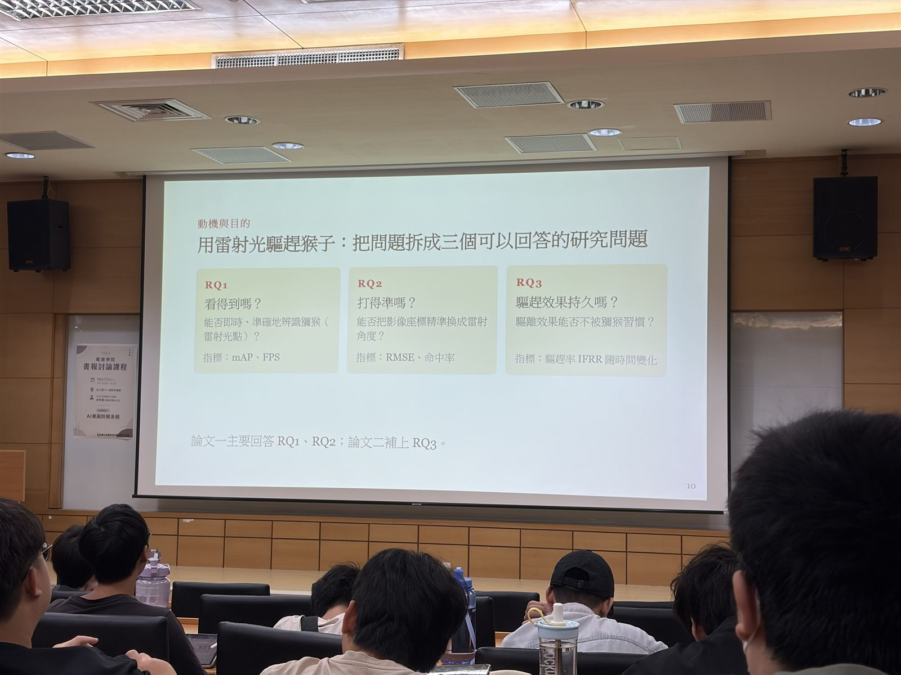

| 研究問題 | 內容 | 指標 |
|---|---|---|
| RQ1 看得到嗎？ | 能否即時、準確地辨識獼猴與雷射光點 | mAP、FPS |
| RQ2 打得準嗎？ | 能否把影像座標精準換算成雷射角度 | RMSE、命中率 |
| RQ3 效果持久嗎？ | 驅離效果能否不被獼猴習慣 | 驅趕率 IFRR 隨時間變化 |

論文一主要回答 RQ1、RQ2；論文二補上 RQ3。

---

## 3. 論文一：即時影像辨識與雷射驅離

- **系統流程**  
  攝影機擷取影像 → YOLOv5n 偵測獼猴 → 伺服馬達調整雷射方向 → 下一張影像重新偵測，並透過 MQTT 與 Web HMI 呈現結果。

- **實驗結果**  
  在實驗室以猴偶模擬果園；訓練資料約 6,000 張影像，從擷取到控制約 38 毫秒，3 公尺內命中率超過 95%。

- **不足之處**
  - 夜間與複雜光線下辨識效果差
  - 多隻獼猴同時出現時容易混亂
  - 「命中」不代表成功驅離
  - 實驗室結果不等於真實果園的長期成效

---

## 4. 論文二：真實果園與抗習慣化

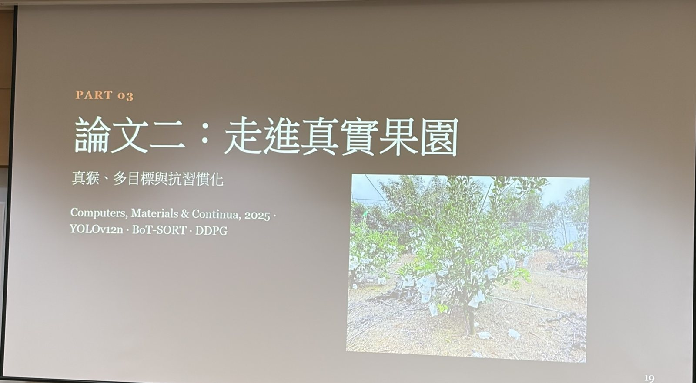

- **場域驗證**  
  在宜蘭頭城果園（約 5 公頃）先觀察 7 天（獼猴平均每天出現約 2.3 次），再進行 21 天策略測試；使用固定式 4 組設備（RGB、NIR、ToF），運算平台為 Jetson Orin。

- **多目標追蹤**  
  以 **BoT-SORT** 追蹤多隻獼猴，避免目標任意切換。

- **增量學習**  
  凍結前 10 層、只調偵測頭，讓模型學會新類別「雷射光點」，又不忘記舊類別「獼猴」。

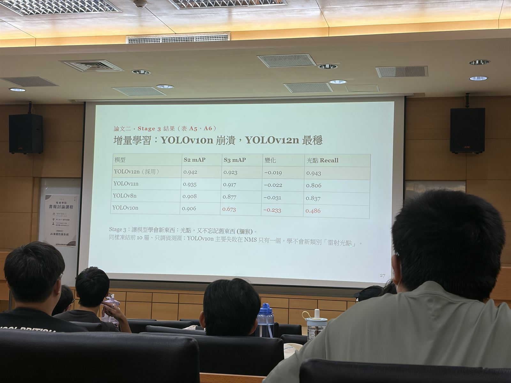

| 模型 | S2 mAP | S3 mAP | 變化 | 光點 Recall |
|---|---|---|---|---|
| **YOLOv12n（採用）** | 0.942 | 0.923 | −0.019 | 0.943 |
| YOLOv11n | 0.935 | 0.917 | −0.022 | 0.806 |
| YOLOv8n | 0.908 | 0.877 | −0.031 | 0.837 |
| YOLOv10n | 0.906 | 0.673 | −0.233 | 0.486 |

- **強化學習 DDPG**  
  把「不可預測性」寫進獎勵函數，重複固定模式會被扣分。

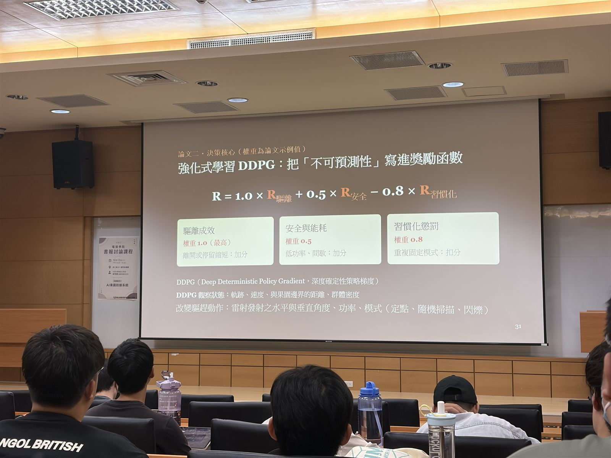

```text
R = 1.0 × R驅離 + 0.5 × R安全 − 0.8 × R習慣化
```

| 項目 | 內容 |
|---|---|
| 觀察狀態 | 軌跡、速度、與果園邊界的距離、群體密度 |
| 驅趕動作 | 雷射水平與垂直角度、功率、模式（定點、隨機掃描、閃爍） |

- **實驗結果**  
  固定與隨機策略的效果隨時間下降；DDPG 每天 IFRR ≥ 80%，第 21 天仍有 **91%**，能「延緩」習慣化。

- **限制**  
  刺激仍只有雷射且沒有真實後果，可能變成「雷射都不可怕」；也需排除新奇效應、季節變化與缺少同期對照的影響，長期效果仍待整個產季驗證。

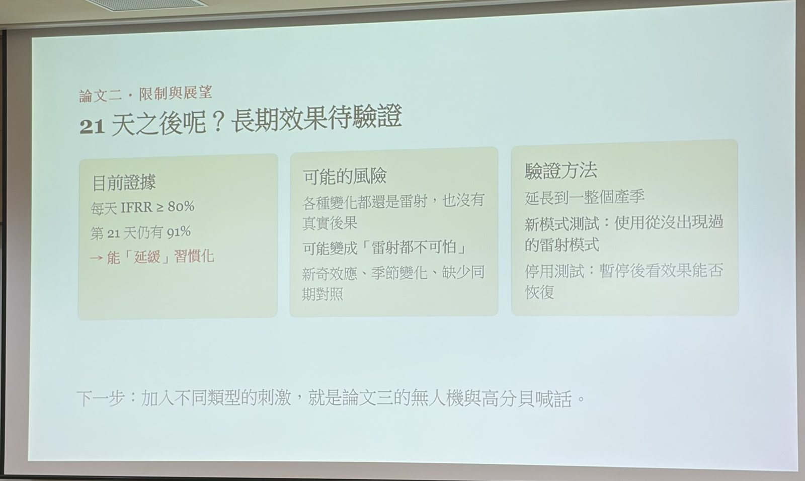

---

## 5. 論文三：感測融合與自主無人機（撰寫中）

- **RGB＋熱影像融合**  
  RGB 提供外觀細節但怕夜間與遮蔽；熱影像可在黑暗中找到動物但幀率較低。論文三以 **BoT-SORT 追蹤**，用連續影格穩定判斷（熱影像 ROI 加 RGB 確認）。

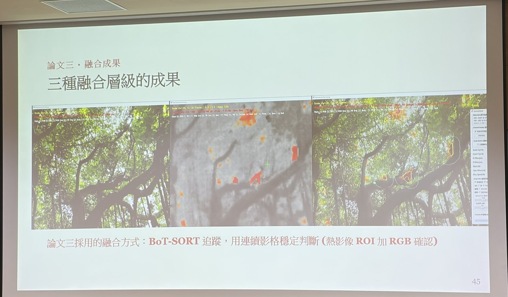

- **自主無人機**  
  結合地面設備與無人機進行空地協同驅離，並加入高分貝聲音，增加刺激的類型。

---

## 6. 三篇論文的演進

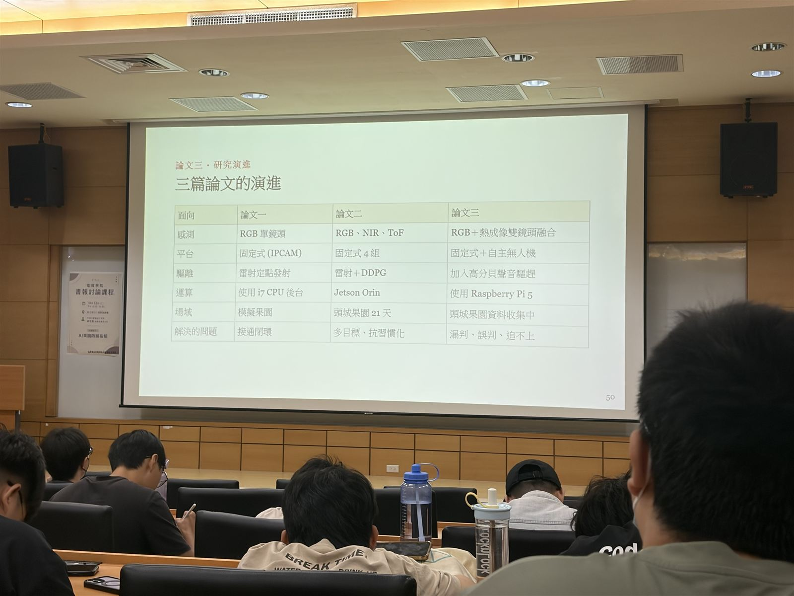

| 面向 | 論文一 | 論文二 | 論文三 |
|---|---|---|---|
| 感測 | RGB 單鏡頭 | RGB、NIR、ToF | RGB＋熱成像雙鏡頭融合 |
| 平台 | 固定式（IPCAM） | 固定式 4 組 | 固定式＋自主無人機 |
| 驅離 | 雷射定點發射 | 雷射＋DDPG | 加入高分貝聲音驅趕 |
| 運算 | i7 CPU 後台 | Jetson Orin | Raspberry Pi 5 |
| 場域 | 模擬果園 | 頭城果園 21 天 | 頭城果園資料收集中 |
| 解決的問題 | 接通閉環 | 多目標、抗習慣化 | 漏判、誤判、追不上 |

---

## 總結

AI 果園防猴系統展示了從 **感測、辨識、追蹤、決策到設備控制** 的完整閉環，並由實驗室模擬逐步走向真實果園。

**論文一** 接通「偵測 → 指向 → 驅離」的流程，**論文二** 以多目標追蹤與 DDPG 對抗獼猴的習慣化，**論文三** 則透過 RGB 與熱影像融合及自主無人機，改善漏判、誤判與追不上的問題。
