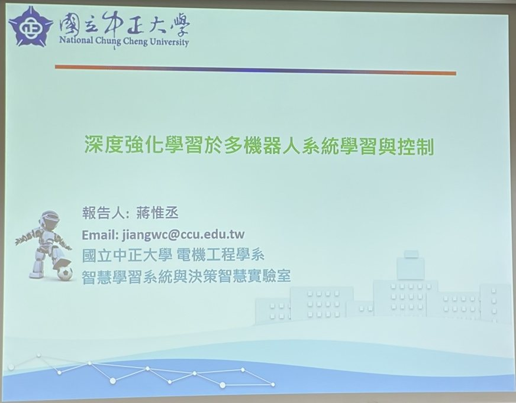
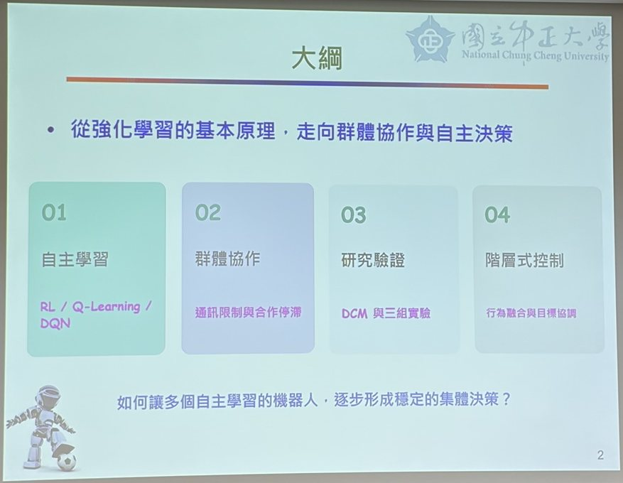
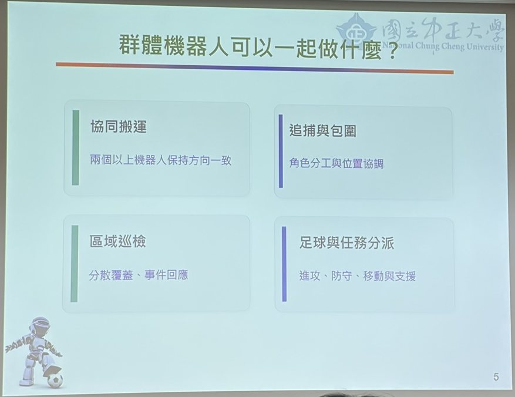
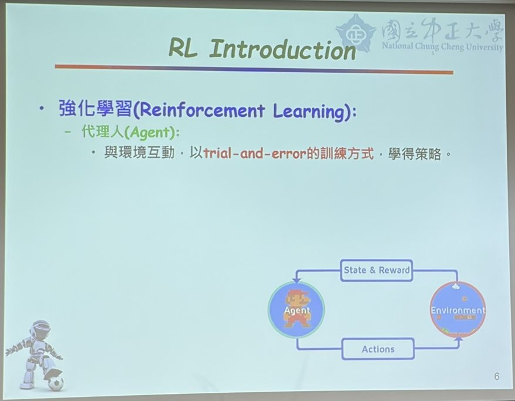
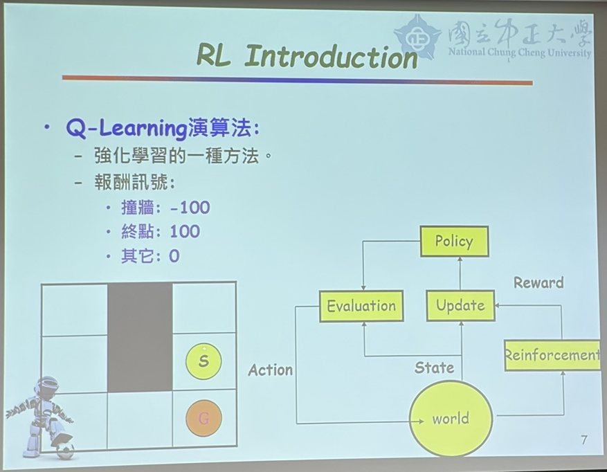
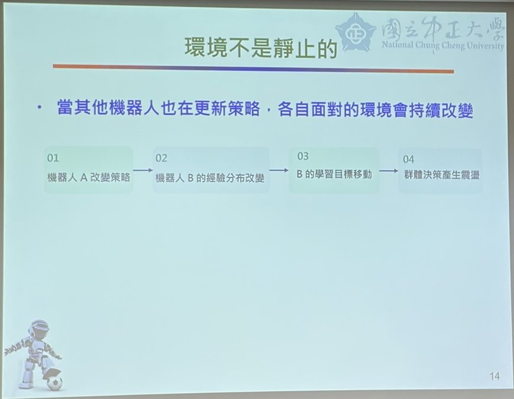
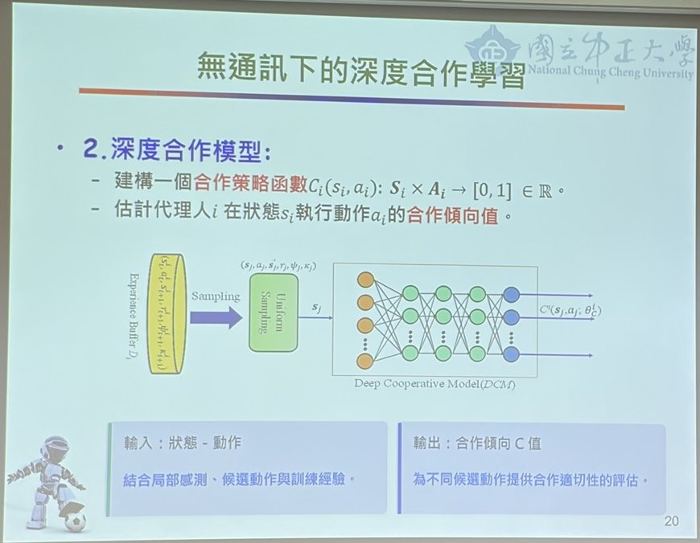
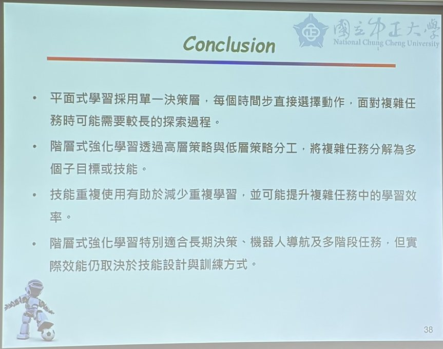

# 深度強化學習於多機器人系統學習與控制



## 核心摘要

本次演講從 **強化學習（Reinforcement Learning, RL）** 的基本原理出發，介紹 **Q-Learning** 與 **DQN**，再延伸到 **多機器人（多代理人）系統** 的群體協作。

多機器人合作時，會遇到 **通訊限制** 與 **環境非靜態（Non-stationary）** 的問題：每隻機器人都在更新策略，彼此面對的環境持續改變，容易造成群體決策震盪與合作停滯。講者提出 **深度合作模型（Deep Cooperative Model, DCM）**，在無通訊的情況下估計動作的合作傾向，並進一步發展 **階層式強化學習**。

核心問題是：**如何讓多個自主學習的機器人，逐步形成穩定的集體決策？**



---

## 1. 代理人（Agent）與多機器人系統

- **代理人的運作流程**  
  機器人（或載具、移動平台）透過感測器從環境感知資訊 → 轉換成 **狀態（State）** 輸入給 Agent → Agent 分析學習後下決策 → 機器人執行 **動作（Action）** 輸出到環境。

- **為什麼需要多隻機器人**
  - **擴大任務範圍**：單一機器人能力有限，例如探索環境時，多隻機器人可分區掃描再共享資訊，節省大量時間。
  - **分工更細**：不同型態的機器人（會飛、地面移動）可負責不同工作。
  - **適應環境能力更強**：異質機器人能克服更複雜的環境。

### 群體機器人可以一起做什麼？



| 任務 | 說明 |
|---|---|
| 協同搬運 | 兩個以上機器人保持方向一致，一起搬運物品 |
| 追捕與包圍 | 角色分工與位置協調，類似多隻狼包圍一隻羊 |
| 區域巡檢 | 分散覆蓋、事件回應，例如核災現場派出多台機器人 |
| 足球與任務分派 | 進攻、防守、移動與支援，例如 Google Research Football 環境 |

---

## 2. 強化學習（Reinforcement Learning）



- **基本概念**  
  Agent 與環境互動，以 **trial-and-error（試誤）** 的方式學得策略。

- **超級瑪利歐範例**  
  瑪利歐一開始只看得到環境的一小部分，不知道該怎麼做。每採取一個動作（往前走、跳），環境就會轉移到下一個狀態，並立即得到 **報酬（Reward）**：被烏龜撞到是不好的報酬，吃到香菇變大是好的報酬。Agent 透過報酬判斷動作好壞，逐步修正策略。

### 機器學習的四種學習模式

| 學習模式 | 特點 |
|---|---|
| 監督式學習 | 資料需要 Label（輸入與對應的正確答案） |
| 非監督式學習 | 資料沒有 Label，依特徵自行分群 |
| 半監督式學習 | 少量有 Label 的資料，搭配大量無 Label 的資料 |
| 強化學習 | 沒有正確答案，透過與環境互動的報酬來學習 |

AlphaGo 即結合了強化學習與監督式學習。

---

## 3. Q-Learning 與 DQN



- **Q-Learning**  
  強化學習中具突破性的演算法，以迷宮為例：Agent 從起點 S 出發，目標是走到終點 G。

### 報酬設計

| 事件 | 報酬 |
|---|---|
| 撞牆 | `-100` |
| 終點 | `100` |
| 其它 | `0` |

- **學習過程**  
  Agent 一開始隨機選擇動作。撞牆得到 -100，就學到「在這個位置不能往這邊走」；走到終點得到 100，就學到「在這個位置要往這邊走」。反覆試誤後，Agent 在任何位置都能找到最快到達終點的路徑。

- **更新公式**

```text
Q(s, a) ← Q(s, a) + α [ r + γ · max Q(s', a') − Q(s, a) ]
```

其中 α 為學習率、γ 為折扣因子。

- **Q-Table 的限制**  
  早期以表格（陣列）儲存 Q 值，每個感測器就是一個維度。若輸入是影像（例如 1024×768），每個像素都是一個維度，表格會 **維度爆炸**，記憶體無法負荷。

- **DQN（Deep Q-Network）**  
  改用神經網路取代表格：先以卷積神經網路（CNN）擷取影像特徵，再由神經網路輸出每個動作的 Q 值（例如上下左右四個），選擇 **Q 值最大** 的動作執行。

---

## 4. 群體協作：合作關係與通訊限制

### 多代理人的合作關係

| 類型 | 說明 | 範例 |
|---|---|---|
| 完全合作 | 所有機器人共享團隊目標 | 協同搬運、Overcooked |
| 完全競爭 | 希望對方失敗、自己成功 | 轟炸超人（Bomberman） |
| 合作與競爭並存 | 隊內合作、隊間競爭 | Google Research Football |

講者目前的研究主要在 **完全合作** 與 **合作競爭並存** 兩類。

### 通訊機制

| 通訊方式 | 優點 | 缺點 |
|---|---|---|
| 完全通訊 | 資訊最完整，合作最合理 | 聯合狀態與動作空間隨機器人數量 **指數成長**，記憶體與通訊量容易爆掉 |
| 部分通訊 | 只分享部分資訊（如位置或動作），合作成本折中 | 資訊不完整 |
| 無通訊 | 通訊負擔最低 | 像兩人蒙眼搬桌子，容易失敗，需要大量試誤時間 |

### 環境不是靜止的



當其他機器人也在更新策略，各自面對的環境會持續改變：

```text
機器人 A 改變策略 → 機器人 B 的經驗分布改變 → B 的學習目標移動 → 群體決策產生震盪
```

在無通訊的情況下，每隻機器人都選擇「自己覺得最好」的動作，但放在一起不一定是團隊最好的結果，容易造成 **合作停滯**。

---

## 5. 無通訊下的深度合作學習（DCM）



- **合作策略函數**  
  建構一個合作策略函數，估計代理人 *i* 在狀態 *sᵢ* 執行動作 *aᵢ* 的 **合作傾向值**：

```text
Cᵢ(sᵢ, aᵢ) : Sᵢ × Aᵢ → [0, 1]
```

- **模型架構**  
  從經驗緩衝區（Experience Buffer）均勻取樣（Uniform Sampling）訓練資料，輸入深度合作模型（DCM）神經網路，輸出合作傾向值。

| 項目 | 內容 |
|---|---|
| 輸入：狀態－動作 | 結合局部感測、候選動作與訓練經驗 |
| 輸出：合作傾向 C 值 | 為不同候選動作提供合作適切性的評估 |

- **研究驗證**  
  講者以 DCM 進行三組實驗驗證，讓機器人在不通訊的情況下，也能較快找到不容易失敗的合作策略。

---

## 6. 階層式強化學習



| 面向 | 平面式學習 | 階層式強化學習 |
|---|---|---|
| 決策方式 | 單一決策層，每個時間步直接選擇動作 | 高層策略與低層策略分工 |
| 任務處理 | 面對複雜任務可能需要較長的探索過程 | 將複雜任務分解為多個子目標或技能 |
| 學習效率 | — | 技能重複使用，減少重複學習 |
| 適用情境 | — | 長期決策、機器人導航及多階段任務 |

階層式強化學習的實際效能，仍取決於 **技能設計** 與 **訓練方式**。

---

## 總結

強化學習讓 Agent 透過 **試誤與報酬** 學得策略；**DQN** 以神經網路解決 Q-Table 維度爆炸的問題。

擴展到多機器人系統時，必須面對 **合作關係**、**通訊限制** 與 **環境非靜態** 的挑戰。**深度合作模型（DCM）** 讓機器人在無通訊下估計動作的合作傾向，而 **階層式強化學習** 則透過高低層策略分工與技能重用，提升複雜、多階段任務的學習效率。
