# 第三類半導體關鍵技術與元件應用

講者：楊智強（國立聯合大學電機工程學系）

如圖 1 所示，為演講封面圖。

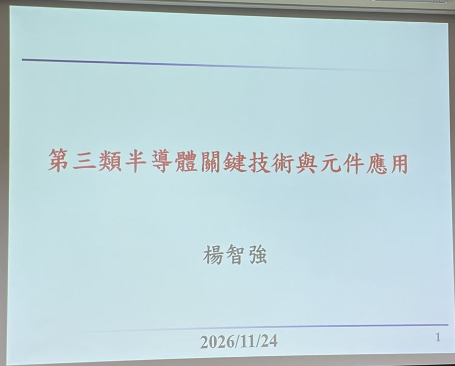

*圖 1 演講封面圖*

## 核心摘要

本次演講從 **2050 淨零排放政策** 與 **電動車、AI 資料中心** 的用電需求出發，說明為什麼需要 **第三類半導體**：氮化鎵（GaN）與碳化矽（SiC）屬於 **寬能隙（Wide Bandgap）材料**，具備 **高耐壓、高功率、高頻、耐高溫** 的特性，是電源轉換、快充、5G/6G 通訊與電動車的關鍵材料。

演講後半段介紹半導體的分類、SiC/GaN 的市場與製程、台灣與國際供應鏈，最後延伸到 GaN 的另一個重要應用：**藍光 LED** 與 **Micro LED**。

核心問題是：**在成本與效能之間，如何為不同的應用選擇合適的半導體材料？**

---

## 1. 講者的研究方向

講者的研究集中在 **寬能隙半導體與光電元件**，並嘗試整合成感測系統。

如圖 2 所示，為相關研究簡介（1/2）圖。

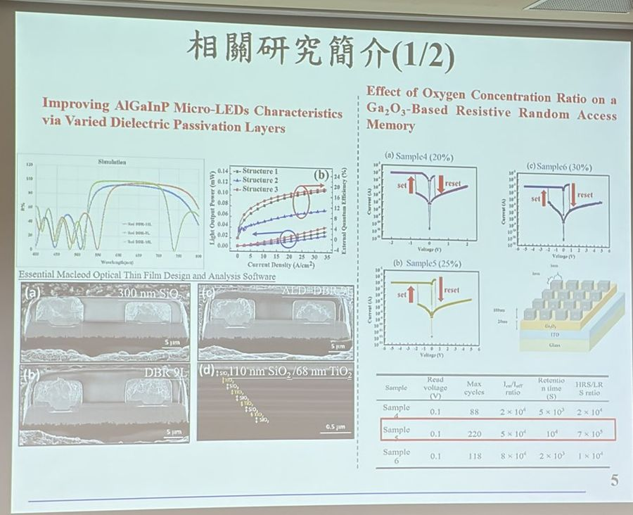

*圖 2 相關研究簡介（1/2）圖*

- **AlGaInP Micro LED 的介電鈍化層**  
  以 Essential Macleod 光學薄膜軟體模擬不同的 **分散式布拉格反射鏡（DBR）**，再實作 SiO₂、DBR、ALD+DBR 等鈍化層結構，透過反射與折射設計提升出光效率。
- **Ga₂O₃ 電阻式記憶體（RRAM）**  
  以濺鍍調整氧氣濃度比例（20%、25%、30%），探討對元件特性的影響。結果以 **Sample 5（25%）** 最佳：最大操作次數 220 次、HRS/LRS 比值 7×10⁵。

如圖 3 所示，為相關研究簡介（2/2）圖。

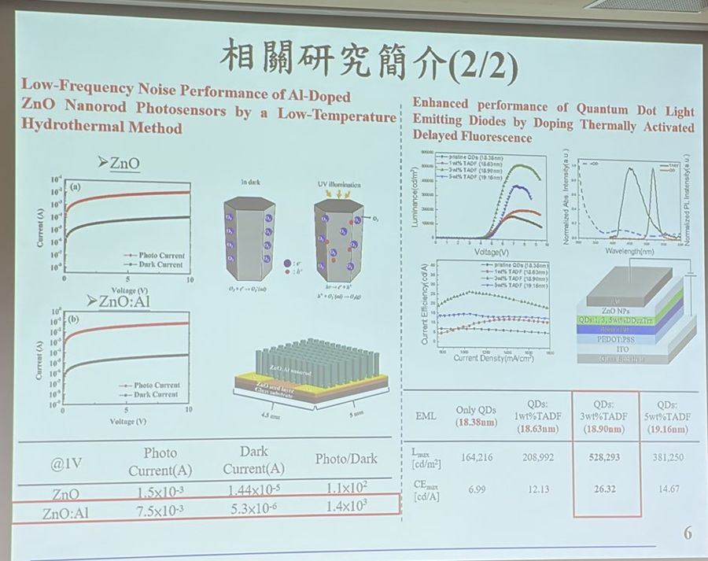

*圖 3 相關研究簡介（2/2）圖*

- **鋁摻雜 ZnO 奈米柱光感測器**  
  以低溫水熱法成長。摻鋁後光暗電流比從 1.1×10² 提升到 **1.4×10³**。
- **摻雜 TADF 的量子點 LED（QLED）**  
  在發光層摻雜熱活化延遲螢光（TADF）材料，以 **3 wt%** 表現最好：最大亮度 528,293 cd/m²、最大電流效率 26.32 cd/A。這類材料怕水氧，實驗必須在手套箱中進行。

如圖 4 所示，為氧化鋅奈米結構自供電系統圖。

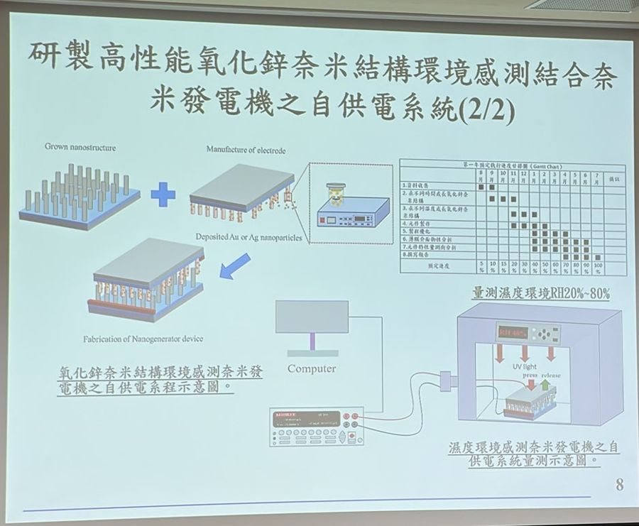

*圖 4 氧化鋅奈米結構自供電系統圖*

- **ZnO 奈米發電機自供電系統**  
  講者第一個國科會計畫：成長 ZnO 奈米結構、沉積 Au/Ag 奈米粒子製作電極，組成奈米發電機，再於 RH 20%～80% 的濕度環境中量測，做成自供電的濕度感測器。

如圖 5 所示，為複合式整合感測器系統圖。

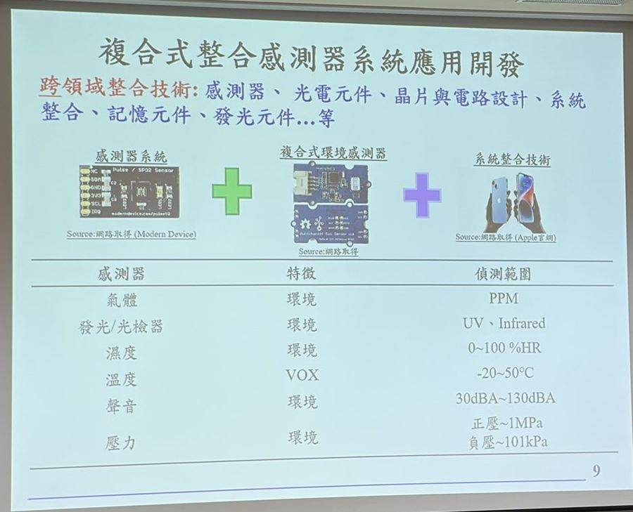

*圖 5 複合式整合感測器系統圖*

- **跨領域整合**  
  把感測器、光電元件、晶片與電路設計、記憶元件、發光元件整合成 **複合式環境感測系統**。講者也提到，現在寫計畫或設計實驗時，會用 AI 輔助發想。

---

## 2. 政策背景：2050 淨零與電動車

講者提醒研究生：**寫計畫時常要引用國家政策**，國發會的資料是很好的來源。

如圖 6 所示，為 2050 淨零路徑規劃圖。

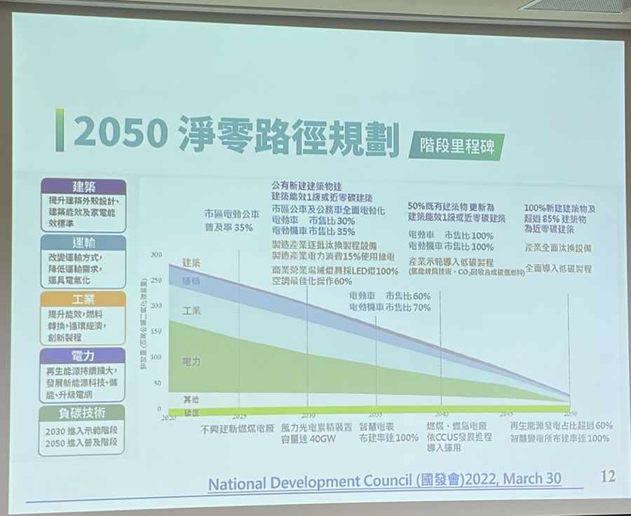

*圖 6 2050 淨零路徑規劃圖*

淨零路徑涵蓋建築、運輸、工業、電力與負碳技術。和第三類半導體最相關的是 **電動車**，如表 1 所示，為電動車推動目標表。

*表 1 電動車推動目標表*

| 年份 | 電動車市售比 | 電動機車市售比 |
|---|---|---|
| 2030 | 30% | 35% |
| 2035 | 60% | 70% |
| 2040 | 100% | 100% |

講者認為目前電動車普及率還沒有達到預期，2040 年全面電動化的期望偏高。台灣禁售燃油車的目標年也是 **2040 年**。

如圖 7 所示，為再生能源政策與能源組成圖。

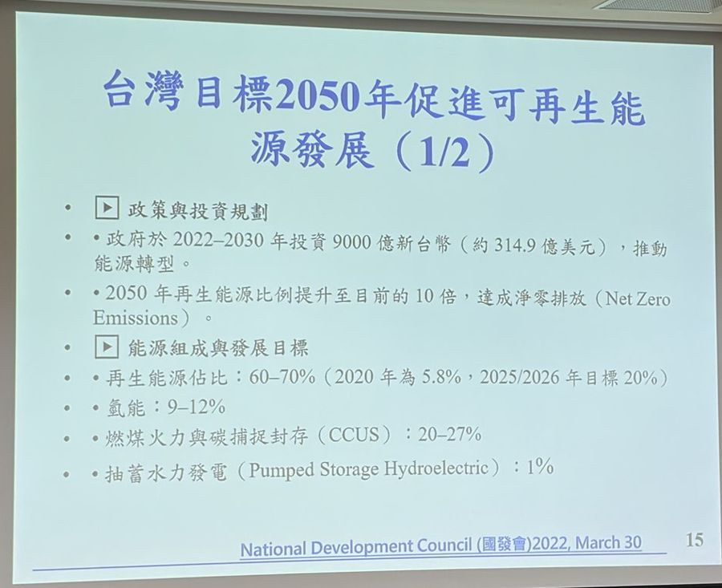

*圖 7 再生能源政策與能源組成圖*

- 政府於 2022–2030 年投資 **9000 億新台幣**，推動能源轉型。
- 2050 年再生能源占比 **60–70%**；氫能 9–12%；燃煤火力搭配碳捕捉封存（CCUS）20–27%；抽蓄水力 1%。

如圖 8 所示，為電力需求與再生能源目標圖。

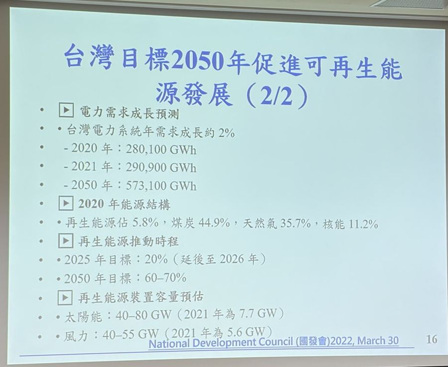

*圖 8 電力需求與再生能源目標圖*

- 電力需求每年成長約 2%，2050 年預估達 573,100 GWh。
- 2020 年再生能源只占 5.8%，20% 的目標延後至 2026 年。
- 2050 年太陽能預估 40–80 GW（2021 年為 7.7 GW），風力 40–55 GW（2021 年為 5.6 GW）。

---

## 3. 為什麼需要第三類半導體

如圖 9 所示，為第三類半導體需求圖。

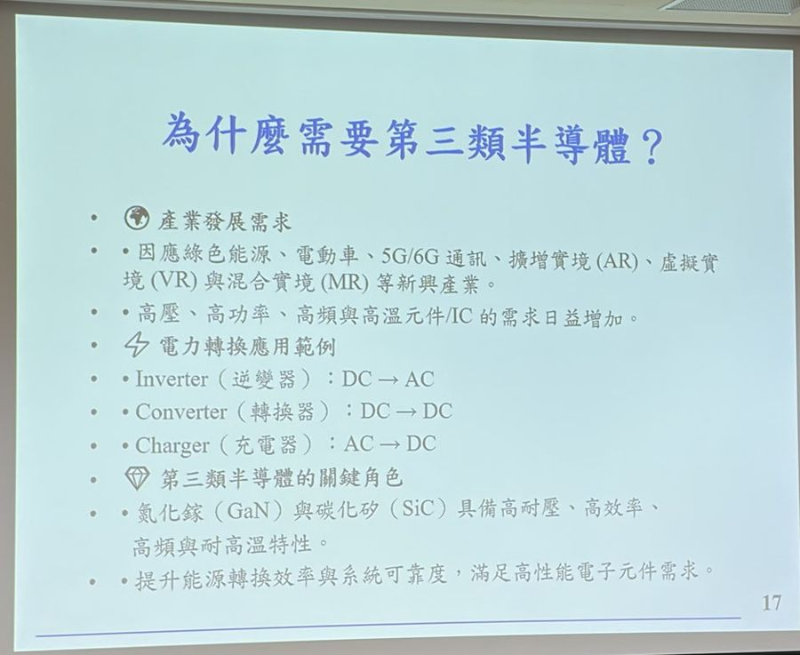

*圖 9 第三類半導體需求圖*

綠色能源、電動車、5G/6G、AR/VR/MR 等新興產業，對 **高壓、高功率、高頻、高溫** 元件的需求增加。這些應用都離不開電力轉換，如表 2 所示，為電力轉換類型表。

*表 2 電力轉換類型表*

| 元件 | 轉換方式 | 例子 |
|---|---|---|
| Inverter（逆變器） | DC → AC | 太陽能併網、電動車馬達驅動 |
| Converter（轉換器） | DC → DC | 電源穩壓 |
| Charger（充電器） | AC → DC | 手機、筆電充電器 |

### 氮化鎵功率元件：逆變器

如圖 10 所示，為氮化鎵電源逆變器圖。

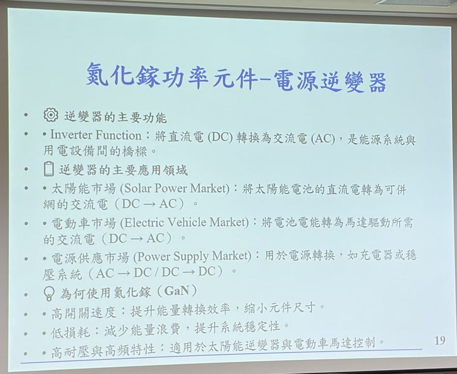

*圖 10 氮化鎵電源逆變器圖*

- **為什麼用 GaN**：開關速度快，可提升轉換效率並 **縮小元件尺寸**；損耗低；耐壓與高頻特性適合太陽能逆變器與馬達控制。
- **生活中的例子**：標示「氮化鎵」的手機快充頭；商務筆電隨附的 65 W 小型充電器，比傳統 100 W、250 W 的大變壓器小很多。
- **家用系統**：太陽能板 → GaN 逆變器 → 家庭用電或併入電網，搭配儲能電池。

---

## 4. 半導體的三種分類

台灣習慣稱「第一類、第二類、第三類」，中國大陸則常說「第一代、第二代、第三代」。講者認為「代」容易讓人誤以為新的會取代舊的，實際上三類各有市場。如表 3 所示，為半導體分類比較表。

*表 3 半導體分類比較表*

| 分類 | 材料 | 類型 | 特性 | 應用 |
|---|---|---|---|---|
| 第一類 | 矽（Si）、鍺（Ge） | 元素半導體 | 低頻、低壓、低功率、成本低 | 邏輯晶片、記憶體、類比晶片、微處理器 |
| 第二類 | 砷化鎵（GaAs）、磷化銦（InP） | 化合物半導體 | 高速、能隙對應紅光／紅外光 | RF 元件、雷射、紅外線、3D 感測、光通訊 |
| 第三類 | 氮化鎵（GaN）、碳化矽（SiC） | 寬能隙化合物半導體 | 高壓、高功率、高頻、耐高溫 | 電動車、快充、5G 基地台、藍光 LED |

### GaN 與 SiC 的差異

- **耐壓**：市售 GaN 約 **650 V**；SiC 可到 **1000–1200 V** 以上。
- **650 V 不是上限**：650 V 是兼顧壽命測試的最佳額定值。不少研究以 GaN 突破 1000 V 為目標，因為 **SiC 成本高**，若 GaN 能取代部分 SiC，電動車價格就能下降。
- **材料特性**：SiC 與 GaN 在能隙、崩潰電場、電子飽和速度上都優於 Si；SiC 的 **熱導率** 特別好，適合高溫高功率封裝。

### 藍光 LED 也是第三類半導體

- GaN 能隙約 3.4 eV，發 **藍光**；GaAs 能隙約 1.4 eV，發 **紅光／紅外光**。
- 手機閃光燈上看到的黃色，是 **黃色螢光粉**。**藍光 LED + 黃色螢光粉 = 白光**，一顆 LED 就能照明。
- 早期用 RGB 三顆 LED 混出白光，只要壞一顆就會偏色。
- 赤崎勇、天野浩、中村修二因發明高效率藍光 LED，獲得 **2014 年諾貝爾物理獎**。

---

## 5. 三大應用市場與成本考量

如圖 11 所示，為第三類半導體三大應用市場圖。

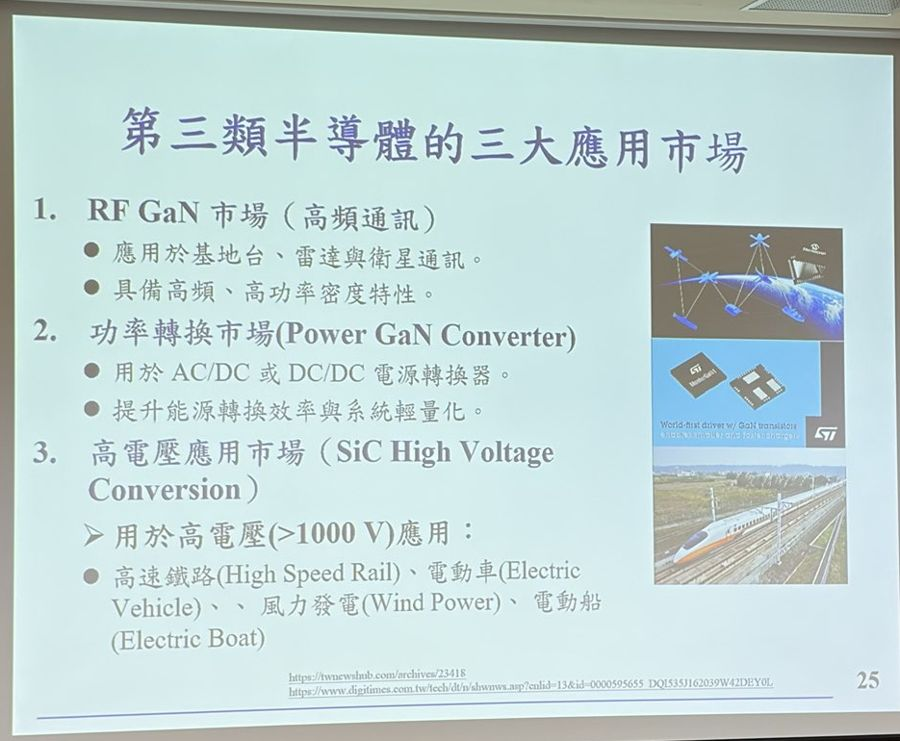

*圖 11 第三類半導體三大應用市場圖*

| 市場 | 材料 | 應用 |
|---|---|---|
| RF GaN（高頻通訊） | GaN | 基地台、雷達、衛星通訊 |
| 功率轉換（Power GaN Converter） | GaN | AC/DC、DC/DC 電源轉換器，提升效率並讓系統輕量化 |
| 高電壓應用（SiC High Voltage） | SiC | >1000 V：高鐵、電動車、風力發電、電動船 |

- **輸出功率 × 操作頻率**：GaN 偏高頻（基地台、手機快充），SiC 偏高功率（電動車、電網、鐵道）；兩者有重疊區，選哪個看成本。低頻低功率的日常應用仍用 Si。
- **SiC vs. Si**：SiC 的導通電阻與損耗較低，系統效率改善可帶來約 5–10% 的續航增益，但材料成本貴很多。這也是 **電動車貴的原因之一**：快充需要耐高壓、高功率的元件。
- **市場產值**：SiC 市場產值高於 GaN，但成本也高。
- **AI 資料中心**：AI 機架越來越耗電，NVIDIA 推動 **800 V 高壓直流** 供電架構，SiC/GaN 是關鍵。

---

## 6. SiC 製程與產業鏈

### 製程流程

```text
長晶爐成長晶棒 → 切片 → 拋光研磨（單面／雙面） → 磊晶 → 黃光微影 → 測試 → 雷射切割 → 封裝
└────── 上游 ──────┘        └── 中游 ──┘        └──── 下游 ────┘
```

- **磊晶 vs. 薄膜**：實驗室常用濺鍍等方式長薄膜，品質有限；**磊晶（Epitaxy）** 能長出單晶薄膜，品質好，但機台動輒上億元。
- **SiC 的難處**：結構複雜、硬度高，6 吋、8 吋晶圓都不容易長，產能與良率受限，成本居高不下。

### 供應鏈

產業分為 **基板、磊晶、IC 設計、製造、封裝測試** 五段。

- **台灣**：台積電與意法半導體（ST）合作生產 GaN 功率元件；環球晶、中美晶投入基板與磊晶；盛新材料是台灣唯一的 SiC 基板廠。台灣在第三類半導體的生產與設備上大致能自主。
- **日本**：三菱電機、富士電機、東芝、富士通等。
- **歐美**：在 SiC 基板與功率元件上掌握大量專利與市占。

### 補充影片

- **工研院 EUV 劑量感測晶圓**：以 12 吋晶圓搭配感測器量測 EUV 輻射劑量，已技轉給台灣半導體龍頭並導入產線（2026 半導體展 29 項創新之一）。
- **Micro LED 光通訊**：AI 資料中心的短距離傳輸，以 Micro LED 把電訊號轉成光訊號，可節省約 50–60% 功耗，與矽光子、CPO 相關。友達等面板廠也以 Micro LED 為發展重點。

---

## 7. LED 與 Micro LED

### LED 發光原理

- **結構**：藍寶石基板 → n-GaN → 多重量子井（發光層）→ p-GaN。
- **原理**：電子與電洞在發光層 **復合** 放出光子。晶片上的蝴蝶狀電極用於 **電流擴散**，每家廠商設計不同，熟悉的人可以從電極形狀認出廠商。
- **能隙調變**：AlN 能隙 6.2 eV、InN 0.7 eV，調整 AlGaN／InGaN 的組成比例就能發出不同波長的光。

### LED 的優缺點

| 優點 | 缺點 |
|---|---|
| 效率高、反應時間短、節能 | 初期成本較高 |
| 光譜可調（RGB 或藍光＋螢光粉） | 散熱不佳 |
| 壽命長、環保 | |

講者以電動車比喻：買價較高，但長期使用的成本較低。

### LED 產業鏈

| 階段 | 內容 |
|---|---|
| 上游 | 藍寶石基板、晶棒、磊晶 |
| 中游 | 晶片製程 |
| 下游 | 封裝（藍光 LED＋黃色螢光粉 → 白光） |
| 應用 | 手機閃光燈、車燈、檯燈、交通號誌 |

### Micro LED

- **定義**：把 LED 縮小到約 **100 µm 以下**（面積約一般 LED 的 1%），每顆 RGB 子像素可單獨驅動。
- **技術瓶頸**：
  - **巨量轉移**：一片 65 吋面板需要轉移、焊接上百萬顆 5 µm 等級的晶粒，還要對準正負極。
  - **修復**：任何一顆壞掉就要更換，否則顏色異常。
  - **效率**：尺寸縮小後效率下降，是目前的研究方向。
  - **成本**：上、中、下游機台成本都隨尺寸縮小而增加。

### 顯示技術比較

| 技術 | 發光方式 | 特色 |
|---|---|---|
| LCD（TFT） | 背光源 + 液晶偏轉 + 彩色濾光片 | 技術成熟、成本低 |
| OLED | 有機材料電流驅動自發光 | 色彩鮮豔、輕薄，目前手機主流 |
| Micro LED | 無機微型 LED 自發光，每顆單獨驅動 | 亮度高、反應快、模組可縮小；無機材料較耐用，仍在研發 |

未來 Micro LED 可能用在電視、大型顯示器與穿戴式裝置。

---

## 總結

第三類半導體（**GaN、SiC**）因 **寬能隙** 而具備高耐壓、高功率、高頻、耐高溫的特性，是 **2050 淨零、電動車、5G/6G、AI 資料中心** 背後的關鍵材料。

三類半導體不是新的取代舊的，而是依需求選擇：**Si** 負責低頻低功率與邏輯運算，**GaAs/InP** 負責高速與紅光，**GaN** 擅長高頻與快充，**SiC** 擅長高壓大功率。決定因素往往是 **成本**，因此「讓 GaN 耐壓突破 1000 V、取代昂貴的 SiC」是重要的研究方向。

GaN 同時也是 **藍光 LED** 的基礎，延伸出的 **Micro LED** 在顯示器與 AI 光通訊都有發展潛力，但仍需克服巨量轉移與效率下降的問題。
